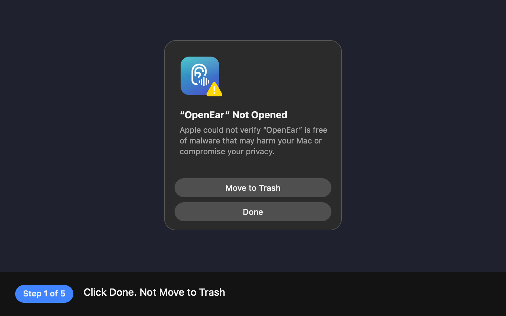

# OpenEar

Transparency mode for wired headphones on your Mac.

AirPods can let the world in. Wired IEMs can't. OpenEar plays your Mac's microphone into your headphones, so you can hear people talking to you without taking your earbuds out. It lives in the menu bar.

## Features

- **Ambient sound** on and off from the menu bar, a timer (15m to 8h, or until a set time) or a weekly schedule
- **Hold to hear**: hold `⌃⌥⌘H` to let the room in, release to go back to quiet
- **Super hearing** makes quiet sounds and voices louder and caps loud ones, so a slammed door won't blast your ears
- **Noise reduction** quiets steady background hiss and hum between sounds
- **Presets**: Home, Office, Café and Outdoors, plus your own. Right-click one of yours to delete it
- **Sound controls**: volume, bass, treble, rumble cut and latency, with a live mic level meter
- **Pause during calls** stops while Zoom, FaceTime or another app uses the mic, and resumes after
- **Sound alerts** notify you about a doorbell, knock, smoke alarm, siren, phone, crying baby, barking dog or shouting, even while ambient sound is off. They can also let the room in for 30 seconds
- **Lower music when someone talks** turns your headphones down while people nearby speak. Off by default
- **Start when headphones connect**, for headphones you've used OpenEar with before
- **Global shortcuts**: `⌃⌥⌘O` toggles ambient sound, `⌃⌥⌘S` toggles super hearing, hold `⌃⌥⌘H` to hear
- **Feedback guard** pauses automatically if your Mac switches to its speakers, and resumes when your headphones come back
- **Recovers by itself** if macOS interrupts the microphone, for example after sleep
- **In-app updates**: OpenEar checks GitHub for new versions. Use **Check for Updates…** in the menu any time
- **Right-click the menu bar icon** for quick actions: ambient sound, super hearing, updates and quit
- **URL commands** for Shortcuts, Raycast or scripts: `open "openear://toggle"` (also `on`, `off`, `super`)

Sound recognition runs on your Mac with Apple's built-in classifier. No audio leaves your computer.

## Install

1. Download the latest `OpenEar-x.y.z.dmg` from [Releases](https://github.com/TheBikramLama/OpenEars/releases).
2. Open it and drag **OpenEar** to **Applications**.
3. Open OpenEar. The first time, macOS blocks it because the app isn't notarized by Apple. Follow [First launch](#first-launch) below. You only do this once.
4. Allow microphone access when asked.

Needs macOS 14 or later on Apple Silicon.

### First launch

<p align="center"></p>

1. When **“OpenEar” Not Opened** appears, click **Done**. Not Move to Trash.
2. Open **System Settings → Privacy & Security**, scroll down to **Security** and click **Open Anyway** next to “OpenEar” was blocked. The button only shows for about an hour after step 1. If it's gone, open OpenEar again and repeat.
3. Click **Open Anyway** again in the dialog that appears.
4. Confirm with Touch ID or your password.
5. Done! OpenEar is in your menu bar.

Comfortable with Terminal? This does the same in one go:

```bash
xattr -dr com.apple.quarantine /Applications/OpenEar.app && open /Applications/OpenEar.app
```

## Tips

- The MacBook's built-in microphones hear the room best. Headphone cable mics mostly pick up your own voice.
- Expect a small delay on your own voice. Software on a Mac can't react as fast as the dedicated chips in AirPods. A lower **Latency** setting helps, until you hear crackling.
- **Pause during calls** is on by default, so you won't hear yourself on Zoom or FaceTime.
- After an update, macOS may ask for microphone access again. Allow it once more.

## Build from source

```bash
scripts/build.sh      # build/OpenEar.app
scripts/make-dmg.sh   # dist/OpenEar-<version>.dmg
```

No Xcode needed; the Command Line Tools are enough.

The app icon and the installer window background are drawn in code. After editing `scripts/render-art.swift`, run `scripts/render-art.sh` to update `assets/`.

## Releasing

Push a version tag. GitHub Actions builds the DMG, signs the update feed and publishes a release with both.

```bash
git tag v1.0.0
git push origin v1.0.0
```

In-app updates need the repository secret `SPARKLE_PRIVATE_KEY`. Tagged builds fail without it. Create it once with Sparkle's `generate_keys` tool, found in `.build/artifacts/sparkle/Sparkle/bin` after a build:

```bash
generate_keys --account openear             # prints the public key for SUPublicEDKey in Info.plist
generate_keys --account openear -x key.txt  # paste key.txt into the secret, then delete it
```

## Licence

OpenEar is MIT licensed. It bundles [Sparkle](https://sparkle-project.org) for updates, which is MIT licensed too.
